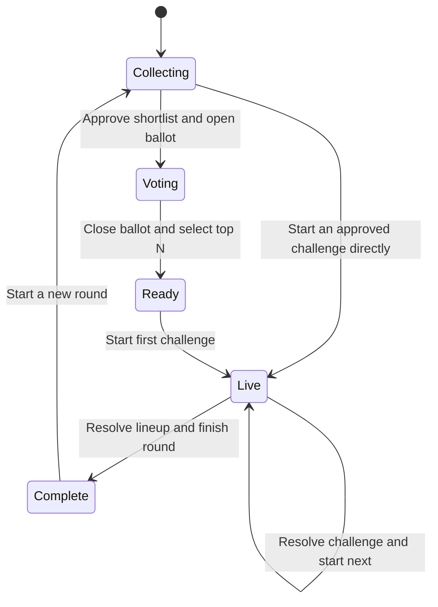
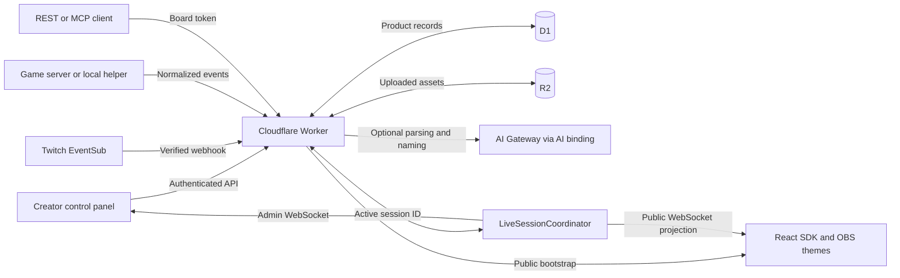

# Challenge.chat

Run streamer-versus-chat challenges during a live broadcast. Viewers suggest ideas, the creator or moderators prepare a shortlist, chat votes, and an OBS overlay follows the attempts and results.

Challenge.chat is also an API-first framework: a headless engine accepts normalized game events, applies rules, and publishes live state. The included React control panel and overlays are replaceable clients. Everything deploys as **one Cloudflare Worker**, with D1, Durable Objects, R2, and optional AI through Cloudflare AI Gateway.

## Documentation

Start with the [documentation index](./docs/README.md) for the full guide set:

- [App screens and workflow](./docs/app.md) and [settings reference](./docs/settings.md)
- [Twitch setup](./docs/twitch-setup.md), [OBS setup](./docs/obs-setup.md), and [AI behavior/cost](./docs/ai.md)
- [HTTP API](./docs/api.md), [MCP / WebMCP](./docs/mcp.md), and [game integrations](./docs/integrations.md)
- [React SDK](./docs/react-sdk.md), [custom themes](./docs/custom-themes.md), and [Durable Object flow](./docs/durable-objects.md)
- [Development](./docs/development.md), [security](./docs/security.md), and [testing/release checks](./docs/testing.md)

Or use the overview sections below:

- [Run locally](#run-locally)
- [How the show works](#how-the-show-works)
- [Architecture and storage](#architecture-and-storage)
- [Deploy to Cloudflare](#deploy-to-cloudflare) — [full deployment runbook](./docs/deployment.md)
- [React overlay SDK](#react-overlay-sdk) — [hooks, themes, elements, events, and sources](./src/overlay/README.md)
- [API, MCP, and integrations](#api-mcp-and-integrations) — [endpoint and security reference](./docs/framework.md)
- [System design](./docs/system-overview.md), [product plan](./PRODUCT_PLAN.md), and [known gaps](./GAPS.md)

## Terms

The UI uses show-friendly names; some API and database names predate them.

| Product term | Meaning | Code/API term |
| --- | --- | --- |
| Board | A namespace for a creator, game, sponsor, or themed series. Owns settings, scores, history, moderators, and the Challenger leaderboard. | `Channel`, `channelId`, `?channel=…` |
| Round | One collection → vote → play → results cycle, optionally named from its selected challenges. | `Session`, `sessionId` |
| Challenge | One task with an objective and optional time/attempt limits. | Challenge/proposal; its attempt is stored in a `rounds` row |
| Framework run | A separate metric-driven execution with declarative success/failure rules. | `ChallengeRun` |

A framework run is not automatically a voted challenge. The reference show uses human adjudication; integrations can use the generic engine for verifiable metrics without assuming every game exposes an API.

## Run locally

Use Node.js **24+** and npm. Tests use Node's built-in SQLite support.

```bash
npm ci
npm run db:migrate:local
npm run dev
```

Open [http://127.0.0.1:5174](http://127.0.0.1:5174). Vite uses that fixed port. On first visit, choose the control-room name and owner password, then create a board. Local D1/R2/Durable Object state is separate from production.

For an environment-managed local password, create `.dev.vars` using [`.dev.vars.example`](./.dev.vars.example) and set `OWNER_PASSWORD`. This overrides the D1-backed password. Do not commit secrets.

The `AI` binding is configured as **remote**, including during local development. AI calls can consume real credits. Turn off challenge parsing and AI titles in the board's AI settings for a no-AI workflow; editing, voting, manual round names, and overlays still work.

```bash
npm test
npm run build
```

## How the show works



1. **Collect.** Viewers send `!challenge …` through connected Twitch chat, or an operator enters an idea. Optional AI turns messy text into structured fields; deterministic parsing is the fallback. The original text is retained.
2. **Review.** The creator or a moderator edits the objective, time limit, and attempt limit, then approves or deselects ideas before voting. Suggestions received outside open intake stay in the board's Inbox.
3. **Vote.** Open a ballot from the shortlist and choose how many challenges advance. Each viewer gets that many distinct votes using `!vote N`. Repeating a vote is an idempotent retry, not an extra vote or an unvote. Shortlist order breaks ties. Unselected ideas return to Inbox.
4. **Play.** Start a challenge, show the pre-start countdown, then switch to a smaller active overlay. Track attempts and pause/resume the timer when needed. The creator or moderator awards the outcome; the app cannot judge arbitrary gameplay from video.
5. **Finish.** Resolve the selected lineup and complete the round. Scores, bonuses, sweep results, and history are preserved. Starting the next round keeps the same board and OBS URL.

Scoring defaults are versioned per board and snapshotted for each round. Classic, Arcade, and Custom modes configure team points, Challenger awards, and optional round bonuses. Changing defaults does not rewrite historical results.

The **Challenger leaderboard** is separate from Streamer-versus-Chat scores. An author earns the configured award when their challenge is selected and another if it defeats the streamer. Approval, votes, and generic telemetry do not themselves award leaderboard points.

## Architecture and storage



| Component | Owns |
| --- | --- |
| Worker | Authentication, board scope, authorization, API/MCP tools, Twitch verification, product operations, and public projections |
| D1 (`DB`) | Boards, active-session pointers, proposals, ballots/votes, show attempts/results, history, contribution awards, settings, and auth/Twitch records |
| Durable Objects (`LIVE_SESSIONS`) | One coordinator **per session**, serialized generic-run state, metric-event idempotency, countdown/deadline alarms, and WebSocket fan-out |
| R2 (`ASSETS_BUCKET`) | Uploaded branding assets |
| AI binding (`AI`) | Server-side requests routed through AI Gateway; not required to operate a board |
| Overlay SDK | Read-only derived scores, clocks, scenes, and elements; never authoritative outcomes |

The Worker resolves the board's active session from D1 before selecting its Durable Object. A new round changes that session ID; the old coordinator closes its sockets, and clients bootstrap/reconnect to the new session. There is not one permanent object containing everything for a board.

The current generic run and accepted-event markers are session-local Durable Object data, cleared when that coordinator is replaced. They are not an append-only event history or D1 archive. Product round results are persisted separately. See [the system design](./docs/system-overview.md) and [Durable Object flow](./docs/durable-objects.md) for update/reconnect sequences and trust boundaries.

## Deploy to Cloudflare

Use the [deployment runbook](./docs/deployment.md) for resource configuration, secrets, Twitch, AI, verification, and troubleshooting.

1. Sign in with `npx wrangler login` and verify the account with `npx wrangler whoami`.
2. Create your D1 database and R2 bucket. Replace the repository's existing **`env.production` resource names and D1 ID** in [`wrangler.jsonc`](./wrangler.jsonc). Keep binding names unchanged.
3. Build production and apply migrations **before** publishing:

   ```bash
   npm run build:production
   npx wrangler d1 migrations apply DB --remote -c dist/worker/wrangler.json
   ```

4. Prepare a private dotenv or JSON file **outside the repository** containing a long, unique `OWNER_PASSWORD`. Publish code and password together:

   ```bash
   npx wrangler deploy -c dist/worker/wrangler.json --secrets-file /absolute/private/path/challenge-chat.env
   ```

5. Open the emitted HTTPS URL, sign in, create the board, and copy its OBS URL. Review AI settings before accepting suggestions.

Do not leave a publicly accessible first-run setup screen unclaimed. Supplying the password with the first upload avoids that window; Cloudflare supports [deploying secrets alongside code](https://developers.cloudflare.com/workers/configuration/secrets/#upload-secrets-alongside-code).

For later releases, after checking the target resources:

```bash
npm test
npm run deploy:production
```

`deploy:production` builds production, migrates D1, then deploys. Existing Worker secrets are retained. **Do not substitute `npm run deploy`:** it uses the top-level demo configuration and deploys before migrating. The environment is selected at build time; use the generated `dist/worker/wrangler.json` for subsequent commands.

### AI configuration and cost

The deployment uses the Worker's `AI` binding, not an AI token entered into each board's settings. Configure `AI_GATEWAY_ID` and `AI_MODEL` in `env.production.vars`; the checked-in values are `default` and `openai/gpt-4.1-mini`.

Create/select that gateway in your account and arrange [AI Gateway Unified Billing](https://developers.cloudflare.com/ai-gateway/features/unified-billing/). The binding path can use Cloudflare-managed provider credentials, so no separate OpenAI API key is needed. See [Cloudflare's binding reference](https://developers.cloudflare.com/ai-gateway/usage/worker-binding-methods/).

Challenge parsing and AI titles are independent per-board switches, **enabled by default**. Turn them off explicitly if you do not want paid requests. With parsing off or unavailable, deterministic cleanup remains; operators can still edit challenges and set limits. With AI titles off, set round names manually. Requested title generation has a deterministic fallback and avoids recently used names for that round without a paid retry loop.

Challenge text and naming context are sent to the model when enabled. The current gateway call also enables log collection; review gateway retention settings for your privacy needs. A fallback is resilience, not a spending cap—configure account-side limits before opening intake to a large audience.

### Twitch connection

In **Settings → Twitch**, copy the deployment's application and OAuth redirect URLs. Register a confidential Twitch application, save its Client ID/Secret in the owner-only form, then choose **Connect broadcaster**. The callback is `/api/twitch/oauth/callback`; the signed EventSub endpoint is `/api/twitch/eventsub`. Public HTTPS is needed for webhook delivery.

The Worker validates signatures, timestamps, replay IDs, and board ownership before applying chat commands or projecting follow/sub/gift/raid/cheer moments. It does not send chat messages. Saved Twitch app/signing secrets are D1 strings without application-level encryption; OAuth tokens are used transiently rather than persisted in the current schema. The [Twitch guide](./docs/twitch-setup.md) and [security reference](./docs/security.md) cover these boundaries.

## OBS setup and routes

Copy the board-specific overlay link from Settings, add it as an OBS **Browser Source**, and set its size to **1920 × 1080**. Keep the page transparent and preserve `?channel=BOARD_ID`. The control panel's selected board does not change an existing OBS source.

Choose a theme, then enable the elements you want: optional widgets start off. Use Studio to preview scenes and game/community events without changing live gameplay state. Theme/settings changes in Studio do persist to the board.

| Route | Purpose | Access |
| --- | --- | --- |
| `/`, `/inbox` | Creator control room and board Inbox | Owner or assigned moderator |
| `/settings/:tab?` | Board settings and deployment integrations | Signed in; owner-only writes enforced by Worker |
| `/setup?channel=…` | Board onboarding | Signed in |
| `/overlay?channel=…` | Transparent live OBS source | Public, read-only |
| `/overlay/studio?channel=…` | Mock scene/event studio and appearance editor | Authenticated; moderator appearance controls read-only |
| `/c/:channelId` | Scoreboard and history | Public when enabled |
| `/invite` | One-use moderator link redemption | Link holder |

## React overlay SDK

The SDK is repository-local TypeScript/React code, **not a published npm package**. The `@/` alias below points to `src/` in this Vite project.

```tsx
import { useState } from 'react';
import { OverlayProvider, OverlayRenderer } from '@/overlay/sdk';
import { createLiveSource } from '@/overlay/sources/live';
import '@/overlay/themes';

export function LiveOverlay() {
  const [source] = useState(() => createLiveSource());
  return (
    <OverlayProvider source={source}>
      <OverlayRenderer />
    </OverlayProvider>
  );
}
```

Mount on a URL carrying `?channel=BOARD_ID`; the live source uses the selected board. Keep the source stable across renders to avoid reconnecting. `OverlayRenderer` reads the board's theme, validated settings, and element switches from the public snapshot.

For a custom component, consume only the data it needs:

```tsx
import { useChallenge, useMetric } from '@/overlay/sdk';

export function ChallengeHud() {
  const { challenge, phase, countdown, clock } = useChallenge();
  const kills = useMetric('kills');
  if (!challenge) return null;
  return (
    <aside aria-live="polite">
      <strong>{challenge.title}</strong>
      <span>{phase === 'countdown' ? `Starts in ${countdown}` : clock?.text}</span>
      {kills && <span>{kills.label}: {String(kills.value)}</span>}
    </aside>
  );
}
```

Read the [overlay SDK guide](./src/overlay/README.md) for a complete theme, hook reference, custom events, source contract, clocks, and testing. Add themes under `src/overlay/themes/` and register them once in `src/overlay/themes/index.ts`; Setup, Settings, Studio, and OBS discover the same registry. Eight themes ship today: Broadcast, Arena, Arcade Clash, Creator Neon, Esports Command, Cozy Corner, Dark Relic, and Comic Chaos.

## API, MCP, and integrations

All board-scoped calls and sockets must preserve `?channel=BOARD_ID`. Omitting it selects the legacy `demo-channel`, not necessarily the board you meant. The Worker resolves IDs against that scope and checks permissions server-side.

| Client | Credential | Intended access |
| --- | --- | --- |
| Creator/moderator UI | HTTP-only session cookie | Control assigned boards; owner-only settings stay owner-only |
| REST board API / remote MCP | Named board token from Settings → API | Bounded board operations, not credentials/settings management |
| Game server / trusted helper | Board integration token | Normalized metric events; trusted voting adapter route |
| WebMCP on creator page | Signed-in owner's cookie | Same tool catalog, when `document.modelContext` is available |
| OBS overlay | None | Public projections only |

From a trusted server or terminal, read board state with a named API token:

```bash
curl 'https://YOUR_WORKER.workers.dev/api/v1/board?channel=BOARD_ID' \
  -H "Authorization: Bearer $CHALLENGE_CHAT_BOARD_TOKEN"
```

The same token works with the Streamable HTTP MCP endpoint at `/mcp?channel=BOARD_ID`. The deployment exposes OpenAPI at `/api/v1/board/openapi.json?channel=BOARD_ID`.

For game integration, start with [`integrations/reporter.ts`](./integrations/reporter.ts), the [example adapter](./integrations/examples/horror-kills.ts), and the [metric-run definition](./src/examples/kill-challenge.ts). Report facts such as `metric.incremented` with stable provider-derived idempotency keys to `/api/v1/runs/:runId/events`. The engine validates them and resolves its rules; the adapter never sets an overlay or awards a result directly. Never ship either bearer token in an overlay or browser bundle.

See [the framework reference](./docs/framework.md) for endpoints, token boundaries, rules, and replay behavior.

## Development map

| Path | Purpose |
| --- | --- |
| [`src/creator.tsx`](./src/creator.tsx), [`src/pages/main/`](./src/pages/main/) | Creator composition and screens |
| [`src/pages/app/ChannelSettings.tsx`](./src/pages/app/ChannelSettings.tsx) | Shared settings body |
| [`src/framework/`](./src/framework/) | Headless React control hooks, API client, board scoping, and theme tokens |
| [`src/overlay/`](./src/overlay/) | Read-only SDK, live/mock sources, themes, and preview controls |
| [`shared/framework.ts`](./shared/framework.ts), [`shared/engine.ts`](./shared/engine.ts) | Versioned metric/event/rule contracts and deterministic engine |
| [`worker/`](./worker/) | Worker API, auth, D1 operations, coordinator, Twitch, and AI |
| [`migrations/`](./migrations/) | Ordered D1 schema migrations |
| [`integrations/`](./integrations/) | Server/local-helper reporter and provider-neutral example |

For creator customization, use `useChallengeChatState` / `useChallengeChatController` from `src/framework/use-challenge-chat.ts` rather than bypassing transport or authorization. Keep runtime themes declarative; custom React code is compiled at deployment time, not uploaded and evaluated as arbitrary JavaScript.

Before releasing, run `npm test` and `npm run build:production`, then follow the [online smoke-test checklist](./docs/deployment.md#online-smoke-test). Automated checks cover the engine, D1 workflows, authorization, adapters, transport, and SDK contracts; they do not replace testing your real Twitch connection and OBS source.
