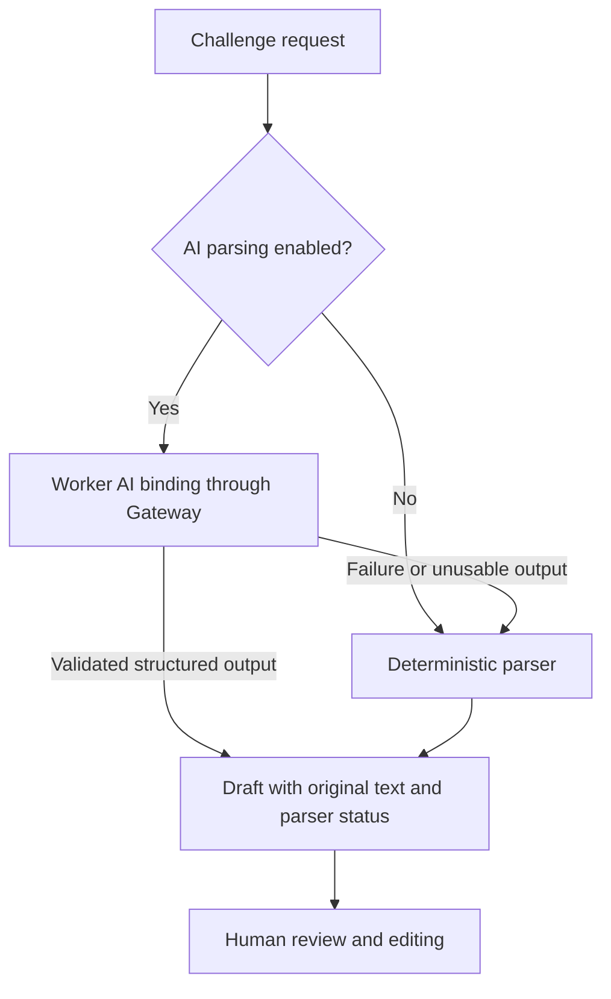

# AI behavior and cost

Configure challenge parsing and round naming without making AI a dependency for running the show. Feature switches are per board; the gateway/model are deployment-wide.

## Feature switches

| Setting | What it controls | With it off |
| --- | --- | --- |
| Use AI parsing (`aiParsing`) | One structured cleanup request for a submitted challenge | Built-in deterministic parsing; operator edits remain available |
| Write challenge titles (`aiChallengeTitles`) | Whether the parsing result supplies an AI-written short title | Built-in title cleanup; parsing can still make a paid request |
| Name rounds automatically (`aiTitles`) | Naming when closing voting and permission to request regeneration | Manual round titles; generation endpoint rejects the request |
| Tone (`aiRoundNameTone`) | `playful`, `hype`, or `straight` naming instructions | Not a separate request/feature |

All three feature switches default to on. For a no-AI board, turn **Use AI parsing** and **Name rounds automatically** off before accepting suggestions. Disabling only title writing is not enough to stop parsing calls. Switches save immediately through the owner-only settings API.

Disabling AI does not reprocess existing drafts or erase saved round names. Manual titles, objectives, time limits, attempts, voting, and adjudication continue to work.

## Request flow

The parser can extract time/attempt limits, targets, context, constraints, difficulty, and warnings. The original request is retained; neither an AI parse nor a warning is proof the task is safe, feasible, or completed. Review inferred limits before putting a challenge on air.

The Worker requests structured JSON and validates it with the shared schemas. On model/binding failure, it falls back to deterministic cleanup. The fallback may require more edits; it does not mean the original text is displayed byte-for-byte as the objective/title.

Closing a ballot requests a name only when AI titles are enabled. **Generate another** also checks that switch and requires a selected lineup. Regeneration avoids a bounded recent-name history for the current round; it is not a global unique-name guarantee. A repeated or failed model result uses a deterministic alternative rather than another paid retry loop.

## Configure the provider

The current code calls `env.AI.run` through Cloudflare AI Gateway using `AI_GATEWAY_ID` and `AI_MODEL`. Defaults in Wrangler are `default` and `openai/gpt-4.1-mini`. Change production values under `env.production.vars`, rebuild, and deploy. The reference Settings UI does not provision a gateway or accept a per-board AI/API token.

Use [the deployment guide](./deployment.md#ai-and-billing) for gateway/billing setup. The AI status endpoint reports whether the binding is configured and which variables are selected. **“AI Gateway ready” is not a real inference test, credit balance, or spending guarantee.** Verify a small real request and its gateway activity separately.

## Billing and privacy

AI can incur charges during submission intake, automatic naming, and explicit regeneration. Local development uses the configured remote AI binding too; local does not mean free/offline for those calls.

Configure gateway/account-side cost controls and review usage before opening high-volume intake. There is no per-board budget ledger or hard monthly spending cap in the application. The feature toggles prevent their own new request paths, but do not cancel an already running request or refund usage.

The Worker sends challenge text or selected-lineup context to the configured model. Current gateway options include log collection and skip-cache behavior. Review logging/retention and disclose model processing as appropriate for your stream. Keep provider secrets out of client bundles, public overlays, and request logs.

## Verify the switches

Use a test board with known starting gateway activity:

1. Turn parsing off; submit a messy request and confirm the deterministic parser status and editable limits.
2. Turn automatic names off; close a ballot and save a manual title. Confirm regeneration is unavailable/rejected.
3. Turn parsing on with real billing configured; submit one request and check both its parsed fields and gateway activity.
4. Turn title writing off while parsing stays on; confirm parsing still works and can still consume a request.
5. Enable round names; generate/regenerate a title and verify saved state/overlay updates.
6. Exercise failure handling in unit tests or an isolated misconfigured test environment, not by changing shared production billing mid-stream.

Relevant code: [`worker/parser.ts`](../worker/parser.ts), [`worker/board-api.ts`](../worker/board-api.ts), [`shared/surface-config.ts`](../shared/surface-config.ts), and [`worker/parser.test.ts`](../worker/parser.test.ts).
