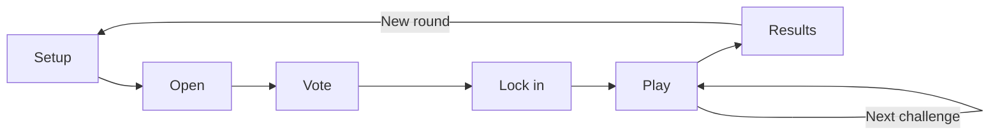

# App screens and show workflow

Use this guide to operate the creator panel and understand which actions change the live show. For individual configuration fields, see the [settings reference](./settings.md).

## Board, round, and challenge

A **board** groups settings, scores, moderators, history, and viewer rankings. Use one for a creator, game, sponsor, or themed series. Its stable ID appears in `?channel=BOARD_ID`; renaming it does not change saved OBS links.

A **round** is one cycle of suggestions, voting, selected challenges, and results. A **challenge** is a single task within that cycle. API/database names still use `Channel` for a board and `Session` for a round. The SDK also has a nested `session.round` representing an individual attempt.

## Screen map

Keep `?channel=BOARD_ID` on board-specific routes.

| Screen | Route | Purpose |
| --- | --- | --- |
| Control room | `/` | Run the current round and inspect scores/history |
| Inbox | `/inbox` | Save suggestions for a later round |
| Settings | `/settings/:tab?` | Configure the selected board and integrations |
| Board setup | `/setup` | Complete first-board onboarding |
| Overlay Studio | `/overlay/studio` | Simulate scenes/events and edit broadcast appearance |
| Live overlay | `/overlay` | Public transparent OBS source; not a control screen |
| Public board | `/c/BOARD_ID` | Viewer-facing scoreboard and history |
| Moderator invite | `/invite?channel=BOARD_ID#token=…` | Redeem a private, one-use sign-in link |
| UI reference | `/ui` | Authenticated component reference for development |

`/overlay-demo` redirects to Studio; `/theme` redirects to Theme settings. Neither is a separate production overlay.

## Sign in and choose a board

The deployment has one owner. Sign in with the owner password; moderators use private invite links. An unconfigured local deployment first asks for a control-room name and password. A public deployment should have its password provisioned before its first upload; follow [secure deployment](./deployment.md#3-protect-the-first-upload).

After sign-in, the app keeps an explicitly selected completed board when accessible, otherwise selects the first completed accessible board. It opens setup only when no suitable completed board exists. The board selector switches namespaces; **New** creates a board with its own initial round. Owners can create boards; moderator access is limited to assigned boards.

The header also links to Inbox, Settings, and overlay elements. Switching the panel's board does not change an OBS source already pointing at another board.

## Control room stages

The server phase is authoritative. The initial Setup and Open screens both map to the backend's `collecting` phase; intake has a separate open/paused flag.

### Setup

Review the board's scores/history and open submissions when ready. You can begin with saved Inbox ideas. This is a fresh show cycle, not another deployment or new board.

### Open

Viewers submit `!challenge` ideas through connected Twitch chat, or an operator submits them through an authenticated API or Dev tool. New ideas enter the current round while intake is open; otherwise they go to Inbox.

Close submissions when you want to prepare the shortlist. The displayed submissions countdown is a pacing guide, **not an automatic server deadline**. You can reopen intake before voting.

Approve ideas to include them in the ballot. Click an approved selection again to deselect it. Open the editor while collecting to change:

- Title, up to 64 characters.
- Challenge text/objective, up to 240 characters.
- Time limit: no limit, or 5–3,600 seconds.
- Maximum attempts: unlimited, or 1–99.
- First numeric target count, when the challenge already has a target.

The UI preserves the viewer's original request and attribution. It does not create a new target field when none exists. Broader structured updates are available through the [API](./api.md). Voting locks challenge drafts against editing.

Choose the number of challenges to select and the ballot duration. The shortlist must contain more ideas than the number advancing, within the board's configured shortlist limit. Ideas outside the ballot return to Inbox.

### Vote

Each entry has a fixed command number. Viewers use `!vote 1`, `!vote 2`, and so on. Ranking can change without changing those command numbers.

Each viewer gets as many distinct votes as the number of challenges advancing. A duplicate vote is a safe retry; votes cannot be removed. The server rejects late or over-limit votes. Ties use original shortlist order.

Close voting early or let the open control panel request closure when its countdown reaches zero. The server enforces the vote deadline even if the panel is closed, but the reference ballot does not have a Durable Object auto-close alarm. Reopen the panel and close an expired ballot if it has not advanced.

Voter detail drawers do not expose a real identity list in the current projection; aggregate totals are authoritative.

### Lock in

Inspect the selected lineup. Set a round title manually, or use **Generate another** if AI naming is enabled. Generation saves the new title; you can then rewrite it. With AI naming off, the manual title field still works.

Reopen voting before any challenge starts if you need more voting time. Existing votes are preserved and selection awards are recomputed on closure. Start the round when ready; challenge 1 begins its pre-start countdown.

### Play

The reference show gives each challenge a **10-second pre-start countdown**. Its gameplay time limit starts after that countdown. Built-in themes use a larger introduction and a compact active card.

The creator or a moderator decides whether arbitrary gameplay satisfies the objective. Use **Streamer wins** or **Chat wins** to record the outcome. **Failed try** increments the attempt count; it does not analyze gameplay or independently adjudicate failure. **Skip** records a non-scoring result and advances.

Pause is available after the countdown and before expiry. It persists to the server and freezes every overlay's timer. Resume shifts the timestamps by the paused duration. Expiry displays time-up; the human-called show still needs an outcome. Generic metric runs have a different, rule-driven timer model.

After a result, choose **Next** or **See results**. Auto-start can count down to that action, with a local **Cancel** to stop it. **Keep one creator panel open if using auto-next**: the countdown runs in that browser, not an unattended server alarm. Avoid multiple panels trying to advance the same show.

Undoing a server-recorded outcome is currently disabled. Confirm the call before awarding it; do not rely on a compensating undo transaction.

### Results

Review team scores, challenge outcomes, and the Challenger recap. Completing a round freezes its result and applies any configured round-win/sweep bonus. All selected challenges must be resolved first.

Start a new round to keep the board's history/rankings and receive a fresh session. The public overlay reconnects to the new session using the same URL.

**Cancel round** is different: it discards the current contest's scores/vote, moves unfinished ideas to Inbox, and prepares a fresh round. Review its confirmation; cancellation is not a pause or an undo of one call.

## Inbox

Inbox holds suggestions submitted outside open intake, unshortlisted ideas, and non-winning ballot entries. It persists across round rotation within the same board.

- During open intake, **Add** moves an idea straight into submissions.
- Outside intake, **Add** marks it for the next opening in the current panel. That staging selection is local UI state; it is not an unattended server queue.
- **Add all** selects the waiting ideas; **Open submissions with N** starts intake with them.
- Opening Inbox marks suggestions as seen; the header badge counts unseen ideas, not all saved ideas.
- The trash action rejects the idea. It is not a database-wide hard-delete operation.

## Scores, history, and public board

Streamer-versus-Chat points and Challenger points are separate. Team scoring comes from challenge results and optional round bonuses. A viewer earns Challenger points when selected and, separately, when their challenge defeats the streamer. Approval and voting do not award those points.

Historical scores use the round's rules snapshot, so later settings changes do not rewrite them. Current history exposes round totals and win counts, not a complete historical challenge-by-challenge drill-down.

The public board polls the public projection every 15 seconds. Its General setting controls whether that **page** displays the scoreboard; it does not make the public overlay/API private. See [security boundaries](./security.md#public-information).

## Pending actions and recovery

Network-backed actions show a pending label/spinner and disable conflicting controls. Wait for success or the displayed error before trying another transition. A timeout or lost response can leave uncertainty about whether a write succeeded: refresh authoritative state before retrying a consequential action.

The creator connection uses WebSockets plus 30-second recovery polling. Read the [testing checklist](./testing.md) for a rehearsal, and [known limitations](../GAPS.md) for controls that are intentionally unavailable.
