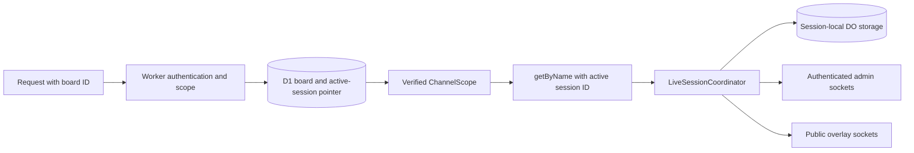
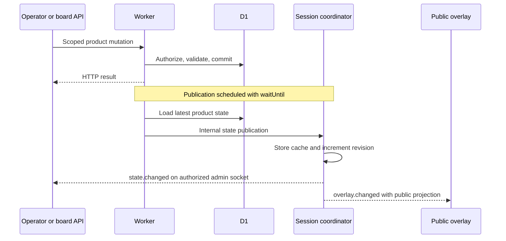

# Durable Object flow

Understand how a board reaches its session coordinator, how product state differs from generic-run state, and what clients must do when a round changes. The implementation is [`worker/live-session.ts`](../worker/live-session.ts); routing/publication is in [`worker/index.ts`](../worker/index.ts).

## Addressing and ownership

The namespace binding is `LIVE_SESSIONS`; its class is `LiveSessionCoordinator`. The Worker calls `getByName(scope.sessionId)` **after** resolving the board and checking operator membership where needed. Do not accept an arbitrary session ID from an untrusted client as the coordinator address.

There is one coordinator per product session, not one permanent object for the whole board. D1 stores board identity, active-session pointer, product history, proposals/votes, rules/settings, auth, and awards. The DO owns its current generic run and live fan-out. R2 owns images. No client connects directly to storage or a DO-internal URL.

## Stored keys and lifetime

| Key | Content |
| --- | --- |
| `legacy` | Cached administrative product-state message for socket bootstrap |
| `legacy:revision` | Revision for that product-state publication stream |
| `framework:live` | Current generic challenge definition and run |
| `framework:idempotency:RUN_ID:SOURCE:KEY` | Marker for an accepted generic event |

WebSocket attachments contain role and, for admin sockets, verified actor/session metadata and expiry. `acceptWebSocket`/socket attachments support the Cloudflare-managed socket lifecycle; application state still comes from durable storage, not in-memory object fields.

This is **not an append-only event store**. Starting another generic run replaces `framework:live`; the current implementation does not archive full run history into D1. Session replacement closes sockets and clears the old coordinator's storage. Product results persist independently in D1. Do not use the cached `legacy` state as the authoritative product database or a complete backup.

## Product writes: D1 first, projection afterward

The reference challenge/vote controls validate and write D1. For successful mutations, the Worker schedules `publishLegacyState` with `ExecutionContext.waitUntil`, resolving the current board/session again and loading its current administrative state. It forwards that state to the coordinator, which caches it and emits the appropriate projections.

HTTP completion and socket publication are separate. `waitUntil` work may begin before or after the client receives its response; the diagram shows the logical split, not a total ordering guarantee. D1 and DO updates are not one distributed transaction, and transient presentation events are not replayable delivery guarantees.

On an uncertain response, read current state before repeating the mutation. A socket failure must not cause a second award, challenge creation, or paid AI request just to force the overlay to update.

## Generic run events: coordinator first

Run creation validates a `ChallengeDefinition`, rejects another nonterminal run, initializes metrics/timestamps, stores `framework:live`, schedules its next alarm, and broadcasts `framework.run.changed`.

For `POST /api/v1/runs/ID/events`, the Worker checks board scope and credentials. Integration tokens may report only metric facts; operators can use authorized lifecycle controls. The coordinator then:

1. Validates the event envelope and rejects externally supplied `run.started`/`timer.expired`.
2. Builds the per-run/source/idempotency key and checks accepted-event markers.
3. Confirms the requested run is the current run.
4. If an active deadline has passed, evaluates expiration before any late metric event.
5. Applies the pure engine reducer using server receipt time, persists updated state and an accepted-event marker, adjusts alarms, and broadcasts the public run projection.

An accepted duplicate returns current state with `duplicate: true`. This protects retries of accepted generic events; it does not create global exactly-once processing across external services, D1 product operations, and UI actions. A rejected event is not queued for later; `occurredAt` does not rewind server time.

Metrics update only while active, with numeric/boolean validation and numeric bounds. Public projections exclude private metrics. A generic run does not automatically award the reference show's challenge or Challenger ledger.

## Timers and alarms

| Timer | Who advances/enforces it |
| --- | --- |
| Reference show pre-start | D1 timestamps; browser derives the 10-second countdown |
| Reference show time limit | Server timestamps, displayed by clients; human outcome still required |
| Reference ballot deadline | D1 rejects late votes; open creator panel requests closure at zero |
| Between-challenge auto-next | Open creator panel's local countdown calls authoritative start/complete APIs |
| Generic run countdown/deadline | Durable Object alarm applies engine-owned events |

Generic countdown alarms apply `run.started` and schedule the deadline. Pause deletes the active alarm; resume extends the deadline by paused duration and schedules it again. Terminal outcomes remove the alarm. Define an appropriate `timer_expired` rule if timeout should resolve success/failure: a timestamp does not invent a rule or a winner.

Do not add per-second D1 writes or broadcasts to animate a timer. Overlays calculate text/progress from supplied timestamps and a shared local clock. Server alarms handle generic lifecycle changes even if all browsers are closed; they do not run the reference control panel's whole show flow unattended.

## Socket scopes and messages

Both scopes upgrade through `/api/v1/live/socket?channel=ID&scope=…`.

| Message | Receivers |
| --- | --- |
| `state.changed` | Authenticated admin sockets only |
| `overlay.changed` | Public overlay sockets only |
| `framework.run.changed` | Both scopes, using public run projection |
| `integration.moment` | Public overlay sockets; bounded normalized Twitch moment |

The Worker verifies admin session, board membership, and allowed origin before forwarding actor/session metadata. Broadcast checks admin expiry; sign-out and membership revocation explicitly close affected sockets. Internal coordinator routes are binding-only implementation details, not external APIs. Never proxy arbitrary internal paths/headers from clients.

## Round replacement and reconnect

Starting a new product round or canceling the current contest creates/resolves a new session in D1 and updates the board's pointer. The old coordinator receives `/internal/session-replaced`, closes sockets with 1012 “Round replaced,” and clears session-local storage.

Clients reconnect through the unchanged **board** URL; the Worker resolves the new session. The real overlay source clears stale run data and refreshes public bootstrap on connect. Its revision stream stays monotonic for the SDK even when the new coordinator's own revision starts again. Scores/results recover from state, not replayed animation events.

The creator hook also polls every 30 seconds for recovery; the public scoreboard page polls every 15 seconds. The real overlay uses its public source/bootstrap/reconnect path rather than the authenticated control hook. Board deletion closes its sockets and invalidates its URLs instead of silently reassigning them to another board.

## Debugging and extension rules

Check board ID → D1 active session → selected coordinator → projection scope in that order. A wrong `channel` parameter can look like a missing update. A successful product write followed by missed publication calls for state recovery, not another consequential mutation.

Add event/rule capabilities through [`shared/framework.ts`](../shared/framework.ts) and [`shared/engine.ts`](../shared/engine.ts), with engine and coordinator tests. Keep provider adapters outside the engine, and keep custom rendering in themes. Preserve the single-Worker deployment and existing Durable Object migration history. See [development](./development.md) and [testing](./testing.md).
