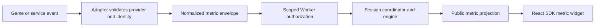

# Game and service integrations

Connect trusted game telemetry, webhooks, or local helpers by reporting normalized facts to the framework. The integration does not decide the outcome, change OBS directly, or impersonate a viewer from unverified browser input.

## Integration path



The example adapter is provider-neutral. It does not claim a working Fortnite/skateboarding API or read arbitrary game video. First establish a legitimate provider API, signed webhook, or trusted local event source for the game you intend to support.

## Prepare a run and token

Create a board-specific **Game event token** in Settings → API / MCP and store it in the helper/server's secret store. Copy the board ID too. A remote reporter requires HTTPS and a token; localhost does not bypass the Worker's actual authorization rules merely because the helper permits an omitted token.

An authenticated operator creates the generic run and defines its metrics/rules. A reporter token cannot create a run. For a rehearsal, Settings → Dev's kill tracker creates the supplied example run and can enable the `kills` widget. The example's success is kills ≥10 and failure is timer expiry.

Only one nonterminal generic run can occupy a session. Retain its returned run ID; discover/provision it through a trusted operator workflow rather than deriving it from an arbitrary client-supplied ID.

## Use the reporter

Save this server/local-helper example beside `integrations/reporter.ts`. It assumes you have already verified the incoming provider event. Supply secrets from your host's environment; never import a configured reporter into an OBS/browser bundle.

```ts
import { createChallengeChatReporter } from './reporter';

export function gameReporter(config: {
  baseUrl: string;
  channelId: string;
  integrationToken: string;
}) {
  const reporter = createChallengeChatReporter({ ...config, source: 'your-game' });
  return {
    enemyDefeated(runId: string, verifiedProviderEventId: string) {
      return reporter.report(runId, verifiedProviderEventId, {
        type: 'metric.incremented', metric: 'kills', by: 1,
      });
    },
  };
}
```

In a separate server/helper, carry over or package [`integrations/reporter.ts`](../integrations/reporter.ts) and its shared types, then adjust the import. A concrete in-repo adapter is [`integrations/examples/horror-kills.ts`](../integrations/examples/horror-kills.ts).

The reporter constructs `idempotencyKey` as `source:providerEventId` and sends the selected board query parameter plus bearer header. Preserve the provider's stable ID when retrying the same fact. Do not create a new random key on every delivery attempt.

## Metric envelope

```json
{
  "source": "your-game",
  "idempotencyKey": "your-game:enemy-123",
  "event": {
    "type": "metric.incremented",
    "metric": "kills",
    "by": 1
  }
}
```

POST to `/api/v1/runs/RUN_ID/events?channel=BOARD_ID`. `metric.set` uses `value` instead of `by`; it supports numeric metrics or a boolean for flags. The metric must exist in the run's definition, and updates are accepted only during active play. A public metric is available to `useMetric(id)`; an integration token does not make private metrics public.

The response is `{ run, projection, duplicate }`. Accepted retries return `duplicate: true` without applying again. `occurredAt` may carry provider metadata, but the server processes with its own time; a late fact cannot backdate itself past a deadline. Rejected events are not a deferred queue.

## Trust and retry policy

Validate provider payload schemas, signatures, allowed game/session IDs, and stable identity before mapping events. Define which source is allowed to report a metric in your deployment. A valid integration token is a trusted credential, not proof of any game event by itself.

Retry accepted-envelope deliveries with the same key after transport failures. Inspect explicit invalid-run/phase/metric errors rather than retrying forever. On round rotation, the old run is gone from the active board path; obtain the new run through your operator workflow. Do not keep publishing to an old ID or use a reporter token as a board-control credential.

For trusted viewer voting, the separate route `/api/ballots/ID/vote` accepts a verified viewer ID with the integration token. Your backend must verify Twitch/extension identity before forwarding it. The built-in Twitch adapter instead verifies EventSub within the same Worker; it does not need an exposed integration bearer.

## Test an adapter

- Validate provider schema/signature failures before any report is sent.
- Report a known metric and check both run state and the real public overlay.
- Repeat the same provider ID and confirm no double increment.
- Reject unknown metrics, wrong types, wrong boards/runs, paused/countdown updates, and late events.
- Rotate the integration token and confirm the old one stops working.
- Change rounds and ensure the integration obtains the new run ID.

Run `npm test` and `npm run build`. Add engine tests only if introducing a new event/rule capability; a new provider adapter should reuse existing contracts where possible. See [HTTP API](./api.md), [Durable Object flow](./durable-objects.md), and [security](./security.md).
