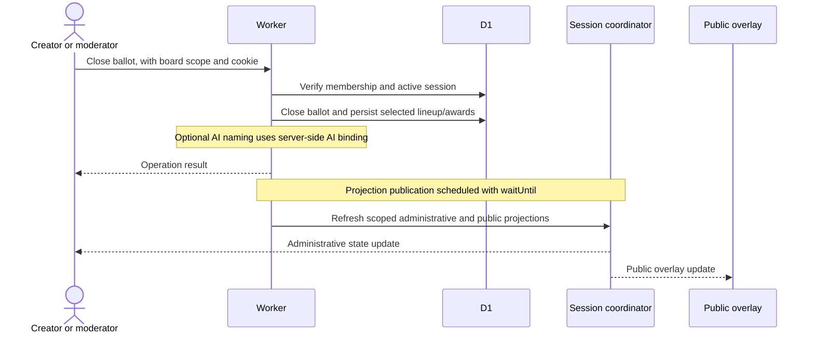
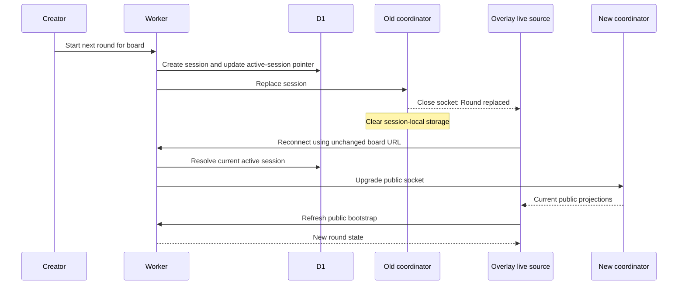

# System design

Challenge.chat is one Cloudflare Worker with two replaceable React surfaces: an authenticated creator control panel and a public OBS overlay. The [README](../README.md) explains the show workflow and terminology. This document covers ownership, live updates, and extension boundaries.

For storage keys, timers, message scopes, and failure/recovery details, read [Durable Object flow](./durable-objects.md). Operating instructions are in [app screens](./app.md) and [settings](./settings.md).

## Two related execution models

The reference show stores proposals, votes, selected challenges, attempts, human-called outcomes, and round results in D1. AI can suggest structured fields and round names, but does not verify a video-game feat. A creator or assigned moderator makes the call.

The generic framework engine accepts a typed challenge definition with counter/gauge/flag metrics and declarative success/failure rules. An adapter reports facts; the server evaluates comparisons, `all`/`any` groups, and timer expiration. Its countdown, active, paused, and terminal states are independent of the show's proposal/voting lifecycle. See the [example definition](../src/examples/kill-challenge.ts) and [framework contract](../shared/framework.ts).

Do not assume that a framework run automatically resolves a selected show challenge or awards its author. A game-specific implementation must explicitly connect the workflows through authorized product operations if that is desired.

## Persistence and coordination

| Data | Authority and lifetime |
| --- | --- |
| Board identity, membership, settings, active session ID | D1; persists across rounds |
| Suggestions, ballots, votes, show attempts/results | D1; scoped to the board/session, with Inbox carry-over |
| Scoring-rule snapshots, completed results, contribution awards | D1; retained for history and rankings |
| Generic run, metrics, accepted event keys, live revision | Active session's Durable Object storage; not a long-term D1 archive |
| WebSocket connections and countdown/deadline scheduling | Session coordinator; alarms persist independently of browser clocks |
| Uploaded branding | R2, served through the Worker |
| Theme ID, per-theme settings, element switches | D1; public appearance projection, with local browser caching |

`LIVE_SESSIONS` addresses a `LiveSessionCoordinator` by the **active session ID**, resolved from the board's D1 record. It is not a permanent per-board database. New rounds receive new coordinators; the old one closes sockets and clears its storage. D1-backed show history survives that rotation; generic run history is not archived there.

## A product update

The control panel shows a pending/disabled action while awaiting the operation. HTTP response and asynchronous publication are separate, not a distributed transaction; the diagram shows the logical split rather than a guaranteed delivery order. The server remains the authority; UI feedback is not authorization or a substitute for state validation.

For normalized game telemetry, the path differs: Worker authorization → coordinator → pure engine reducer → Durable Object storage → public/admin projections. Stable `source` and `idempotencyKey` fields make accepted retries safe. Only one nonterminal generic run can occupy a session; integrations cannot emit server-owned timer/start transitions or overtake a deadline with a late event.

## Round rollover and recovery

The live source preserves `?channel=…`, clears its stale generic-run cache, and refreshes bootstrap state after reconnect. The SDK keeps a monotonic local revision stream and derives scenes from the current public snapshot. It interpolates display clocks from timestamps instead of sending per-second writes.

Snapshot-diff events are presentation hints, not a durable event log. They do not replay history on first hydration; transient community moments may be missed while disconnected. Scores and outcomes must come from authoritative state, not from counting browser animations.

## Board isolation and credentials

Every data operation resolves a `ChannelScope` from D1. The Worker checks owner/mod membership and verifies that supplied challenge, ballot, run, or session IDs belong to the selected board. Never address a coordinator directly from an arbitrary client-provided session ID.

The owner can manage all boards. Moderators can operate assigned boards but cannot manage credentials, branding, or scoring defaults. Cookies are HTTP-only; unsafe cookie-authenticated writes and admin WebSocket upgrades require the permitted origin. Revocation closes affected sockets and subsequent requests recheck membership.

Named board tokens authorize bounded REST/MCP show operations for one board. Integration tokens authorize normalized metric intake and the trusted voting-adapter route. Neither belongs in browser or overlay code. WebMCP uses the signed-in owner's same-origin session, not a token embedded in JavaScript.

Public overlays receive a separate projection without owner passwords, session cookies, invite tokens, integration/API tokens, or administrative credentials. Twitch webhooks require HMAC/timestamp/replay validation before becoming show actions or transient public moments. Current Twitch credential storage limitations and secure bootstrap are documented in [deployment security](./deployment.md#security-and-backups).

## Scoring and AI boundaries

Board scoring defaults are copied to rounds before the contest is underway. Historical snapshots and earned contribution-ledger amounts prevent later settings changes from rewriting old scores. Team scores and Challenger rankings are distinct: selection and defeating the streamer award Challenger points; approval, votes, and generic metrics do not.

Challenge parsing and round naming are independently switchable per board, enabled by default. AI calls use deployment-level gateway/model configuration through the Worker. Disabled parsing uses deterministic cleanup; disabled titles use manual names. Requested generation can fall back on errors. No AI step is required for manual moderation, challenge limits, voting, or resolution.

## Replacing or extending a surface

- Creator composition starts at [`src/creator.tsx`](../src/creator.tsx). Use [`use-challenge-chat.ts`](../src/framework/use-challenge-chat.ts) rather than duplicating control transport.
- Public rendering uses the [React overlay SDK](../src/overlay/README.md). Themes consume public state; layout is separate from engine rules.
- Add built-in themes under `src/overlay/themes/`, registered once in its index. Settings are bounded primitive configuration; runtime arbitrary JavaScript is not supported.
- Game/service adapters live outside the engine and report normalized facts through the [reporter](../integrations/reporter.ts). Validate provider signatures/identities before reporting.
- New event kinds or rule types extend [`shared/framework.ts`](../shared/framework.ts) and [`shared/engine.ts`](../shared/engine.ts), with engine tests.

Keep these boundaries even when replacing both reference surfaces. The [framework reference](./framework.md) lists routes and contracts; the [deployment runbook](./deployment.md) covers operations.
