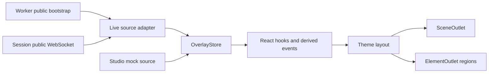

# React overlay SDK

Build read-only broadcast graphics from a normalized live snapshot. The SDK supplies scores, clocks, lineup, metrics, leaderboard, and presentation events; themes decide how they look. It does not approve ideas, resolve challenges, or authorize writes.

This is repository-local React/TypeScript code, not a published package. Examples use this project's `@/` → `src/` alias. Start at the [root README](../../README.md) for local setup, OBS configuration, and deployment.

## Data flow



Live and mock sources are alternatives, not simultaneous inputs to a production overlay. `/overlay` uses the live source; `/overlay/studio` uses the isolated mock for simulated game state. Studio appearance changes still persist to the board.

| Directory | Responsibility |
| --- | --- |
| [`sdk/`](./sdk/) | Snapshot types, store, provider, derived models, hooks, clocks, events, theme registry/rendering |
| [`sources/live.ts`](./sources/live.ts) | Public Worker/Durable Object transport → SDK snapshot adapter |
| [`themes/`](./themes/) | Compiled React themes; `broadcast/` is the base and `kit/` supports variants |
| [`mock/`](./mock/) | Simulated show, chat, metrics, and autoplay |
| [`controls/`](./controls/) | Scaled previews and schema-driven appearance forms for the creator UI |

## Mount a live overlay

```tsx
import { useState } from 'react';
import { OverlayProvider, OverlayRenderer } from '@/overlay/sdk';
import { createLiveSource } from '@/overlay/sources/live';
import '@/overlay/themes';

export function LiveOverlay() {
  const [source] = useState(() => createLiveSource());
  return (
    <OverlayProvider source={source}>
      <OverlayRenderer />
    </OverlayProvider>
  );
}
```

Keep `?channel=BOARD_ID` in the page URL. `createLiveSource()` uses the scoped URL helpers to fetch `/api/public/state` and connect to `/api/v1/live/socket?scope=overlay`. It accepts no explicit board argument. Reconnection refreshes public state and follows a replacement session without changing the OBS link.

Keep the source identity stable, as above: changing it disconnects/reconnects the provider. The provider renders nothing until its first snapshot by default, appropriate for transparent OBS output.

| `OverlayProvider` prop | Purpose |
| --- | --- |
| `source` | Optional `OverlaySource`; the provider connects it and cleans up on unmount |
| `initial` | Optional complete `OverlaySnapshot` for a still or initial state |
| `store` | Optional existing `OverlayStore` to share/control externally |
| `fallback` | Optional content before the first snapshot; defaults to `null` |

`OverlayRenderer` normally reads `snapshot.display`. Its optional `theme`, `settings`, and `elements` props override those values for a preview; they do not save board configuration. Unknown theme IDs fall back to the first registered theme (Broadcast in the built-in registry); an empty registry renders nothing.

Board-owned appearance is stored in D1 and projected as `display`. [`src/data/overlayConfig.ts`](../data/overlayConfig.ts) supplies browser-side compatibility/cache helpers; it is not production's source of truth.

## Read state with hooks

Call these inside `OverlayProvider`. Theme-specific hooks additionally require `OverlayRenderer`'s theme context.

| Hook | Returns / use |
| --- | --- |
| `useChallenge()` | `{ challenge, slot, phase, clock, countdown, attempts, call, next, upNext }`; challenge may be `null` |
| `useClock(which)` | `ClockView` or `null`; `which` is `round` (default), `ballot`, `submissions`, or `next` |
| `useBallot()`, `useSubmissions()` | Voting rows/shares/counts or intake ideas, including their clocks |
| `useScore()`, `useStreak()`, `useLineup()`, `useAttempts()` | Narrow views of the current round |
| `useLeaderboard(limit?)`, `useSeason()` | Challenger ranking and cumulative board results |
| `useMetric(id)`, `useMetrics()` | Public generic-run metric(s); missing metric returns `null` |
| `useSponsors()` | Sponsor data from the source |
| `useStage()`, `useScene()` | Current lifecycle stage or rendered scene |
| `useSides()`, `useSideName(side)`, `useChannel()` | Public identity, names, and colors |
| `useDisplay()`, `useConnection()` | Appearance configuration or connection status |
| `useRound()`, `useBoard()` | Broad derived show/board models; prefer narrower hooks in small widgets |
| `useSnapshot()` | Raw normalized public snapshot |
| `useOverlaySelector(fn, options?)` | Custom selection; optional `{ time: true, equal }` |
| `useOverlayEvent(type, handler)` | Presentation events; accepts one type, an array, or `'*'` |
| `useNow()` | Server-adjusted time, checked four times per second; prefer clock hooks |

SDK `useRound()` follows the current product round/session. Its `challenge` is the individual task being attempted. The SDK's nested `session.round` is that attempt, a legacy naming distinction worth keeping in mind.

### Countdown and compact active graphic

The `live` scene includes both pre-start and active play. `useChallenge().phase` distinguishes `countdown`, `playing`, `paused`, `timeup`, and `called`; it can also be `null`. Render the larger introduction only while counting down, then reduce the active card's footprint:

```tsx
import { useChallenge } from '@/overlay/sdk';

export function LiveCard() {
  const { challenge, phase, countdown, clock, attempts } = useChallenge();
  if (!challenge) return null;
  const intro = phase === 'countdown';
  return (
    <section style={{ width: intro ? 480 : 280, padding: intro ? 24 : 12 }}>
      <strong>{challenge.title}</strong>
      {intro && <p>{challenge.objective}</p>}
      <div>{intro ? `Starting in ${countdown}` : clock?.text}</div>
      <small>By {challenge.by} · Attempt {attempts?.current ?? 1}</small>
      {phase === 'paused' && <span>Paused</span>}
    </section>
  );
}
```

Clocks are server epoch **milliseconds**: `{ startsAt, endsAt, pausedAt }`. Challenge `timeLimit` is in **seconds**. A future `startsAt` means countdown; `endsAt: null` means untimed. Pause/resume comes from authoritative timestamps, not a client command.

`ClockView` includes `text`, `elapsed`, `remaining`, `duration`, `progress`, `startsIn`, `pending`, `running`, `paused`, and `expired`. Timed text counts down; untimed text is elapsed time prefixed with `+`. The store shares a local clock and corrects its offset from server time, avoiding per-second API writes. Clock views are cached until their displayed seconds change; broad selectors may still rerender for other state.

## Create a theme

A theme provides a full-canvas layout, scene components, optional elements, and a settings schema. This complete minimal example can live at `src/overlay/themes/my-show/index.tsx`:

```tsx
import {
  defineTheme, ElementOutlet, SceneOutlet,
  useChallenge, useScene, useScore,
} from '@/overlay/sdk';

function Layout() {
  const { accent } = myShow.useSettings();
  return (
    <div style={{ position: 'relative', width: 1920, height: 1080, color: accent ?? undefined }}>
      <div style={{ position: 'absolute', right: 40, bottom: 40 }}>
        <SceneOutlet />
      </div>
      <div style={{ position: 'absolute', left: 40, top: 40 }}>
        <ElementOutlet region="hud">
          {({ id, on, Component }) => on ? <Component key={id} /> : null}
        </ElementOutlet>
      </div>
    </div>
  );
}

function StatusCard() {
  const scene = useScene();
  return <div style={{ background: '#15151d', padding: 20 }}>{scene}</div>;
}

function LiveCard() {
  const { challenge, phase, countdown, clock } = useChallenge();
  if (!challenge) return null;
  const intro = phase === 'countdown';
  return (
    <div style={{ background: '#15151d', padding: intro ? 24 : 12, width: intro ? 480 : 280 }}>
      <strong>{challenge.title}</strong>
      <div>{intro ? `Starts in ${countdown}` : clock?.text}</div>
    </div>
  );
}

function Scoreboard() {
  const { score } = useScore();
  return (
    <div style={{ background: '#15151d', padding: 12 }}>
      Streamer {score.streamer.points} — {score.chat.points} Chat
    </div>
  );
}

export const myShow = defineTheme({
  id: 'my-show',
  name: 'My Show',
  settings: {
    accent: { type: 'color', label: 'Accent', default: '#f6cb57' },
  },
  Layout,
  scenes: {
    idle: StatusCard, open: StatusCard, vote: StatusCard, lock: StatusCard,
    live: LiveCard, result: StatusCard, done: StatusCard,
  },
  elements: {
    scoreboard: { label: 'Scoreboard', region: 'hud', Component: Scoreboard },
  },
});
```

The non-live scenes deliberately show only their names in this starter; replace them with voting, result, and recap graphics. A scene omitted from `scenes` renders nothing, not a fallback live card.

Register it **once** in [`themes/index.ts`](./themes/index.ts): import `myShow` from `./my-show` and append it to `BUILT_IN`. That file already registers the array. Do not also register inside the theme module, and do not hard-code its ID into Setup, Settings, or Studio. After deployment, select the theme and enable its Scoreboard element.

### Layout and element contract

- Design for a transparent **1920 × 1080** canvas. The preview controls handle scaling; do not put a full-page opaque background behind gameplay.
- `SceneOutlet` selects the current scene and remounts it when `useSceneKey()` changes, letting entrance animations replay for each challenge/result.
- `ElementOutlet` filters by the region name you choose. It passes `{ id, on, label, Component }`, **including off elements**, so the render function controls mounting/exit animations.
- Optional elements default to off. Elements are independent of scenes and remain wherever the layout places them.
- Reuse conventional IDs such as `scoreboard`, `leaderboard`, `goal`, `kills`, and `sponsor` when their semantics match, so switches carry across themes.
- `useElementOn(id)`, `useThemeSettings()`, and `theme.useSettings()` require the renderer's theme context. Prefer `theme.useSettings()` for inferred types.

### Settings and variants

`defineTheme()` infers the schema's settings for `theme.useSettings()`. Settings drive the same schema-generated creator form and render values.

| Type | Fields / validation |
| --- | --- |
| `boolean` | Boolean `default` |
| `number` | `default`, `min`, `max`, optional `step`/`unit`; finite values clamped to range |
| `select` | String `default`, `options: [{ value, label }]`; unknown selection falls back |
| `color` | Six-digit hex or `null`; null can follow board colors when your component implements it |
| `text` | String `default`, optional `placeholder`/`maxLength`; truncated to the limit |

All settings support `label`, optional `description` and `group`. Unknown fields are discarded by resolution. The Worker validates bounded primitive configuration; theme schema resolution supplies exact defaults on the React side. Themes are compiled code, not arbitrary runtime scripts uploaded by viewers.

For a smaller customization, extend a built-in theme instead of recreating every scene:

```tsx
import { extendTheme } from '@/overlay/sdk';
import { broadcast } from '@/overlay/themes/broadcast';

export const myBroadcast = extendTheme(broadcast, {
  id: 'my-broadcast',
  name: 'My Broadcast',
  settings: {
    sponsorLabel: { type: 'text', label: 'Sponsor label', default: '', maxLength: 80 },
  },
});
```

`extendTheme` merges settings, scene maps, and element maps, and keeps the base layout unless replaced. A new setting has no visual effect until a component consumes it.

The eight built-ins are Broadcast, Arena, Arcade Clash, Creator Neon, Esports Command, Cozy Corner, Dark Relic, and Comic Chaos. Styled variants share the Broadcast/kit components while supplying their own CSS and signature elements. Inspect [`themes/broadcast/`](./themes/broadcast/) for a fuller implementation.

## Presentation events

The store derives events by diffing snapshots. Initial hydration does not replay historical derived events. Use them for animations and sounds, not accounting or authoritative game logic:

```tsx
import { useState } from 'react';
import { useOverlayEvent } from '@/overlay/sdk';

export function WinnerAnnouncement() {
  const [message, setMessage] = useState<string | null>(null);
  useOverlayEvent('round.call', ({ winner, challenge, points }) => {
    setMessage(`${winner} wins ${points}: ${challenge.title}`);
  });
  useOverlayEvent('stage', () => setMessage(null));
  return message ? <div role="status">{message}</div> : null;
}
```

Supported event types are `stage`, `idea`, `votes`, `lineup`, `round.start`, `round.attempt`, `round.pause`, `round.resume`, `round.call`, `round.undo`, `round.end`, `lead`, `streak`, `session.end`, `metric`, `goal`, and `custom`. Payloads are typed in [`sdk/types.ts`](./sdk/types.ts).

A source can emit `sink.event({ type: 'custom', name: '…', data: … })`. Broadcast's Alerts element understands normalized Twitch `follow`, `sub`, `gift`, `raid`, and `cheer` names. Real Twitch events must pass Worker verification; game facts should enter through the framework metric-event API. Transient overlay events are not a durable replay queue, and emitting a custom event does not change a score or persist a result.

## Sources and snapshots

An `OverlaySource` has `connect(sink): () => void`. The returned function must stop timers, close sockets, and release subscriptions.

| Sink method | Meaning |
| --- | --- |
| `snapshot(next)` | Replace complete normalized state |
| `patch(part)` | Shallow-merge top-level fields; nested objects such as `session` must be complete replacements |
| `status(value)` | `connecting`, `live`, `reconnecting`, or `offline` |
| `event(value)` | Send a presentation moment without changing snapshot state |

Full snapshots contain `revision`, `serverTime`, `channel`, `sides`, `session`, `history`, `challengers`, `scoring`, `metrics`, `sponsors`, and `display`. Lower revisions are ignored; a custom source must maintain a monotonic revision stream, including after reconnects. Replace nested values immutably so selectors observe changes.

Live Challenger standings already include the active session's awards, so the live adapter sets `challengerPointsIncludeCurrentSession: true`. A mock/replay supplying pre-session standings should leave it false/absent so derivation can add current awards without double counting.

Here is a non-network source for a captured public snapshot:

```tsx
import type { OverlaySnapshot, OverlaySource } from '@/overlay/sdk';

export function stillSource(snapshot: OverlaySnapshot): OverlaySource {
  return {
    connect(sink) {
      sink.snapshot(snapshot);
      sink.status('live');
      return () => {};
    },
  };
}
```

Do not pass administrative state as a snapshot. Build custom production sources from a public projection, and keep credentials out of both the source payload and bundle.

### Mock a scene

```tsx
import { useState } from 'react';
import { OverlayProvider, OverlayRenderer } from '@/overlay/sdk';
import { createMockSource } from '@/overlay/mock/source';
import '@/overlay/themes';

export function ThemePreview() {
  const [source] = useState(() => createMockSource({
    scene: 'live',
    hold: true,
    display: { theme: 'broadcast', settings: {}, elements: { scoreboard: true } },
  }));
  return (
    <OverlayProvider source={source}>
      <OverlayRenderer />
    </OverlayProvider>
  );
}
```

Mock controls include `seed(scene, winner?)`, `setAutoplay(on)`, `pause()`, `resume()`, `call(side)`, and metric updates. These simulate local state only. `hold: true` keeps a preview in its selected scene, reseeding before its clock runs out. Never import the mock source into the real `/overlay` route.

## Verification and extension boundaries

Run `npm test` and `npm run build` after SDK/theme changes. Tests cover hooks/events/theme settings, live-source mapping, metrics, and transport. Use authenticated Studio to inspect idle/open/vote/lock/live/result/done, both winners, countdown/paused/untimed/expired states, long text, and off/on elements. Then test the real public OBS route and round rollover.

For a new game adapter, publish facts using [`integrations/reporter.ts`](../../integrations/reporter.ts); do not write an overlay directly. For a new metric/event/rule capability, change the versioned framework contract and add engine tests rather than hiding game logic in a theme. See [the framework map](../../docs/framework.md).
